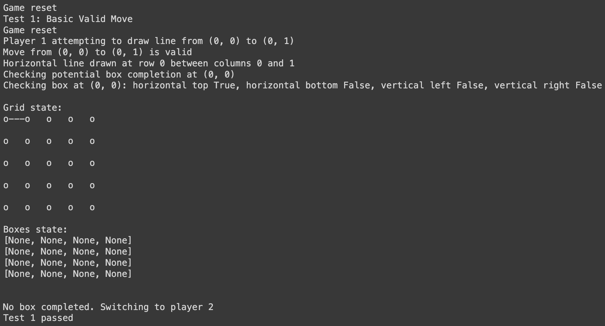

# Dots and Boxes

A dependency-free Python implementation of the two-player pencil-and-paper game, with move validation, box ownership, scoring, turn handling, and terminal output.

## Quick start

```bash
git clone https://github.com/stefanjuang/DotsAndBoxes.git
cd DotsAndBoxes
python DotsAndBoxes.py
```

This runs the bundled self-tests. No third-party packages are required.

To use the game from Python:

```python
from DotsAndBoxes import DotsAndBoxes

game = DotsAndBoxes(3, 3)  # 3 × 3 dots, giving 2 × 2 boxes
game.draw_line((0, 0), (0, 1))
game.display()
```

Coordinates are zero-based `(row, column)` tuples. Use positive integer dimensions of at least 2 in each direction; constructor validation is not implemented.

## Game behavior

- A move joins two horizontally or vertically adjacent dots.
- Duplicate, diagonal, out-of-bounds, malformed, and non-adjacent moves are rejected.
- Completing a box adds one point and keeps the current player's turn. One edge can complete two boxes.
- A valid move that completes no box passes the turn.
- `draw_line` returns `True` when a box is completed. It returns `False` both for an invalid move and for a valid move that passes the turn.
- `reset()` clears the board and scores. `is_game_over()` checks whether every box is owned, and `get_winner()` returns player 1, player 2, or `None` for a tie.



## Code and tests

[DotsAndBoxes.py](DotsAndBoxes.py) contains the game and `run_tests()`. The bundled runner includes 13 named scenarios, numbered 1–9 and 11–14, covering normal moves, invalid input, scoring, player changes, game completion, and a two-box move.

The script completed successfully on Python 3.12.14 during the documentation review. Some scenarios exercise a path without asserting its postconditions, so this is a small self-test suite rather than exhaustive correctness coverage.

[Overview_Understanding.ipynb](Overview_Understanding.ipynb) provides an implementation walkthrough.

## Scope

This is a terminal-oriented game-logic example, not an interactive command-line game, GUI, or AI opponent. Methods print diagnostic output. The core module can be imported without running the self-tests; run the file directly or call `run_tests()` to execute them.
